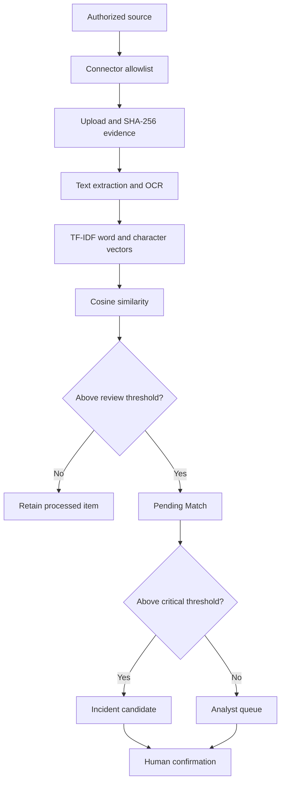

# ExamGuard AI Architecture

## Evidence flow

Every external item is normalized into an `Upload`. The record stores its source, external identifier, capture time, content type, URL when applicable, SHA-256 fingerprint, extracted text, and connector metadata. Duplicate external identifiers from the same source are idempotent.

PDFs with a text layer are extracted directly with PyMuPDF. Scanned PDF pages and images use PaddleOCR when configured and available, otherwise pytesseract. The matcher combines word n-grams and character n-grams so it remains useful when OCR introduces small spelling errors.

## Core model relationships

- `Authority` owns many `Exam` records and may own authorized `Source` records.
- `ExamType` classifies NEET, JEE, state-board, university, and other exams.
- `Exam` owns protected `Paper` records and defines review/critical similarity thresholds.
- `Paper` owns zero or more `Question` records. When questions exist, matching is question-level; otherwise the full extracted paper text is used.
- `Source` defines a public, explicitly authorized private, or owner-controlled test origin.
- `Upload` represents one captured message, page, document, image, or manual submission.
- `Match` connects an upload to a paper and optionally one question.
- `Incident` is created for critical candidates but stays unconfirmed until an officer acts in Django Admin.

## Connector design

| Connector | Supported scope | Ingestion method |
|---|---|---|
| Public web page | Allowlisted public URL | Scheduled `monitor_sources` command |
| RSS/Atom | Allowlisted public feed | Scheduled `monitor_sources` command |
| Licensed search/API feed | Configured endpoint | Scheduled `monitor_sources` command |
| Telegram Bot API | Chats that deliberately added the bot | Signed webhook |
| Telegram MTProto | Public channels and explicitly authorized private sources | `monitor_telegram` command |
| WhatsApp Business | Messages delivered to the authority's business number | Signed Cloud API webhook |
| Manual | Authorized officer submission | Django Admin |

“All websites” is not a technically truthful scope. The scalable approach is a maintained source registry plus licensed search/provider feeds. This implementation intentionally refuses local/private network URLs, enforces content-size limits, observes robots rules, records errors, and makes source coverage measurable in Admin.

## Production evolution

Move scheduled commands to Celery workers and Celery Beat, use Redis for queues, store documents in encrypted private object storage, place malware scanning before OCR, send alerts through approved channels, and export audit events to append-only security storage. The synchronous commands in this repository keep the demonstration understandable and independently testable.
